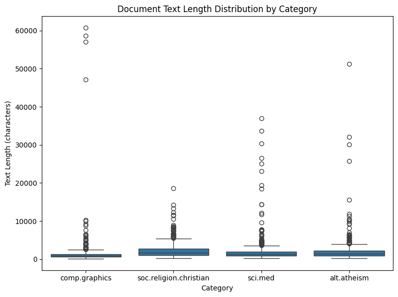
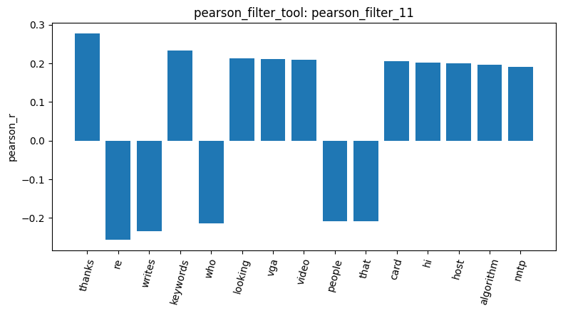
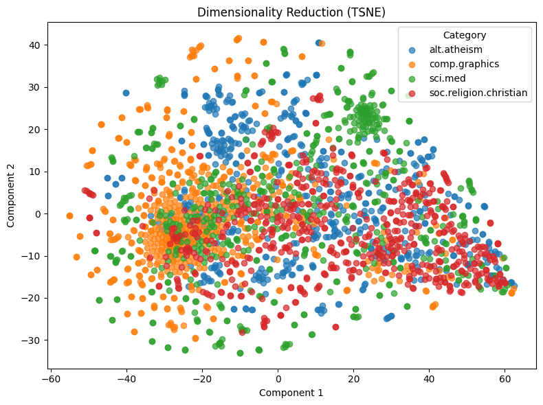

The data includes 4 categories, 2,257 documents (load_dataset_1) in total.There's no missing text (check_missing_3) and duplicates. (check_duplicates_4)

First of all, from the document length statistics  (describe_data_5), I found that comp.graphics has the shortest median (883.0 characters) but the longest max (60,713.0 characters), so we know that these posts are mostly short with a few very long outliers. 

Second, from the sampled posts (sample_data_6), it can be observed that the subjects and the document categories appear to be highly related. 
"subject" is not in the top 20 word frequency  (term_freq_8). I guess it appears about once in each document, so it's around 2257 times (presumed from the number of documents). and surprisingly, "edu" ranked 16th with 4,675 occurrences (term_freq_8)and appears way more frequent than I expected. One reason I can think of is the email domain, probably many users use their institution email.

The variance filter (variance_filter_10, threshold 0.05)  keeps words whose counts vary a lot across documents, without using the categories, but if stop word cleaning does not execute first, it captures mostly stop words because their counts vary the most between short and long posts, so it returns 'the', 'of', 'to', but removes 'civilians', 'jury', 'targa'.
From pearson (pearson_filter_11, target comp.graphics, threshold 0.1), it can be inferred that comp.graphics posts usually ask for help, so they often thank other users ('thanks' is positively correlated with comp.graphics), and they rarely build up long threads, since they use “re” less often than the other categories.

All ten stop words are positively correlated, from 0.53 to 0.94(feat_corr_13), but "you" has weaker correlations with the others,maybe because "you" depends on whether a post is talking to someone, not only on length. 

I faced error when using the mine tool, because Windows uses cp950 encoding by default, which can’t write non-ASCII characters like “é” into the temporary file for PAMI. My fixture only had ASCII words, so my tests didn’t catch it. I fixed it by adding strip_accents="ascii" in AgentDev and ran the tool again in a new chat. The results show that the top patterns were email header words such as "lines" and "subject" (mine_patterns_2).

From the t-SNE figure I can see that comp.graphics have similar wordings in their posts, whereas soc.religion.christian and alt.atheism are more scattered, which suggests a wider range of word choices. (reduce_tsne_16)

I did cosine similarity test for Doc 0 to Doc 2. Doc 0 and Doc 1 are both comp.graphics, but their cosine similarity was only 0.3532 (cosine_sim_18). Moreover, when we compared Doc 0 (comp.graphics) and Doc 2 (soc.religion.christian), 0.3399 (cosine_sim_19) is almost the same as 0.3532, so stop words and headers dominate the raw-count cosine similarity.
Later on, with build_dtm_tool with max_df=0.5 (dtm_21), I saw that only 28 terms were removed, but they appeared in more than half of the documents. The cosine similarity calculation returned 0.0706 (down from 0.3532) for same category pair, while cross-category pair is 0.0776 (down from 0.3399, cosine_sim_23), which confirms that most of the original similarity came from the 28 frequent words, and that these three documents differ from each other to a similar extent.

